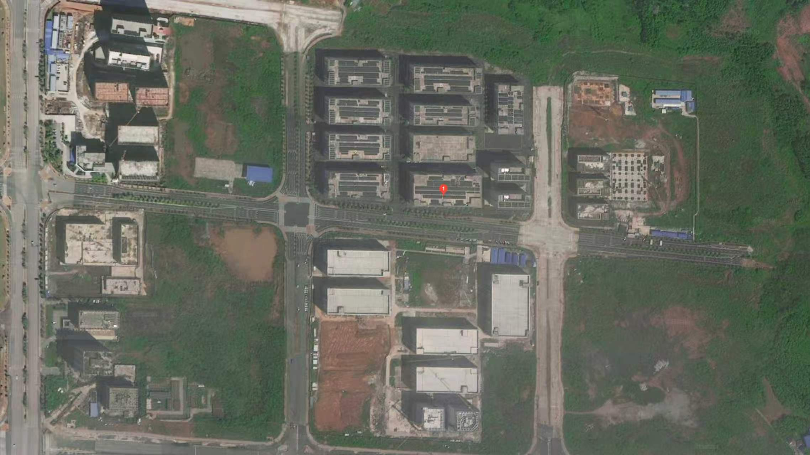

---
title:
titleEn:
date:
update:
description:
author:
  - zhenliu
category:
  - 未分类
status: public
---
---
## 场地信息

## 新功能需求2026-10-22
### 企业级研发区域增加需求
- 配备独立的空调制冷系统
- 实验操作主区域：面积800㎡
- 实验室配套区：剩余100㎡，
- 开放式L型卡位区域：50-60个L型工位

### 消费级实验室增加需求
- 实验专业作业区需由原来的550㎡增加至700㎡
- 办公区35个L型卡位
- 空调系统要能够方便调节温度和风量

#### 实验室区域需求
- 1、测试架摆放位40个、大型实验设备摆放位10个(需接水接电)。
- 2、仪器操作台区、样品存放区、工具耗材存放区。
- 3、一间临时休息室约50m2、一间可容纳30人的会议室约60m2、一间物品收纳室约40㎡
- 一间独立隔断的硬件调控室约80m2，包含硬件焊接区(要靠近窗户安装抽焊锡烟管)。放置示波器、ET机等设备的放置区，以及硬件测试区。
- 独立门禁、所有区域互相连接、地面采用耐磨防滑防静电材质，预留电路/通风、排风系统接口、专用强弱电线路、消防配套设施，适配专业实验作业标准。
## 功能与面积需求 4365
### 实验室 2300
- 50-60 L 卡位 1500m²
- 消费类研发实验室：35个工位，800m²
### 食堂 500
- 500m² 60人
### 办公 340
董事长 40m²
办公室 2间 30 x 2=60m²
会议室
- 会议室a  100m² （20人）
- 会议室b  80m²（10人）

### 接待  345
- 接待室：临电梯 85m²
- 洽谈室  30 x 2 =60m²
- 接待包间：
- 150m²（20人）
- 110m²（14人）
### 配套 900
健身区 500m²（乒乓球，健身器材）
茶水+休息区 300m²
储物间 100m²

