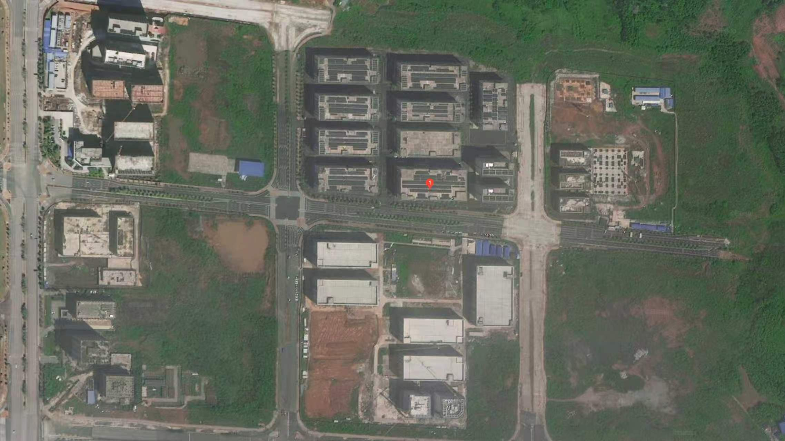

---

## 文本构架
### 设计概念
### 
## 推荐框架

### 01 项目理解与设计目标

简要建立整个项目的共同方向：

- 研发实验与办公协同；
- 商务接待与企业形象；
- 员工餐饮与休闲配套；
- 高效、专业、现代的整体空间气质。

这一章只负责定调，不展开细节。

### 02 设计前提与技术策略

把两个方案共用的技术内容集中解释一遍，避免后面重复。

建议包括：

- 原建筑条件与核心筒限制；
- 实验室通风、排风、湿度、防静电和隔音要求；
- 设备用水、用电及强弱电条件；
- 实验室门禁和安全管理；
- 餐饮排烟及后勤关系；
- 消防疏散和主要通道；
- 采光面与安静、噪声空间的关系。

这部分控制在3—5页，以示意图为主。概念汇报中不需要变成机电专项，只要说明“平面是基于哪些技术条件形成的”。

### 03 总体平面方案

这一章集中讲两个方案的组织区别。

#### 方案一

- 整体平面；
- 大功能分区；
- 访客、办公、实验、餐饮及后勤流线；
- 方案特点总结。

可以概括为“高效集约型”：

> 两个实验室共用墙体，减少中间交通面积，提高空间利用率，同时增强实验室的独立性和私密性。

#### 方案二

采用完全相同的表达方式：

- 整体平面；
- 大功能分区；
- 各类流线；
- 方案特点总结。

可以概括为“参观展示型”：

> 两个实验室之间设置独立参观通道，通过玻璃展示界面形成研发参观路径，强化实验空间的可视性和企业展示能力。

#### 方案对比

我建议把对比放在两个平面讲完之后，而不是整份PPT最后。因为两个方案唯一的差异就是平面组织，趁甲方还对两张图有清晰记忆时完成比较最有效。

对比重点控制在：

- 空间利用率；
- 实验室私密性；
- 参观展示效果；
- 两个部门之间的联系；
- 日常管理便利性；
- 流线是否会互相干扰。

比较完成后，可以先形成一个阶段性结论：

> 两个方案采用统一的室内设计语言，主要区别在于对“使用效率”和“参观展示”的不同侧重。

这样就能自然进入后面的共同空间意向。

### 04 空间设计意向

这一章不再区分方案一、方案二，而是按照空间类型讲共同的设计方向。

建议分为四至五类：

1. 实验研发空间  
    实验室、开放实验区、设备房、焊接房、静电测试房。
    
2. 办公协作空间  
    开放办公、独立办公室、会议室、洽谈室。
    
3. 商务接待空间  
    接待大厅、董事长办公室、商务接待室、商务包间。
    
4. 员工生活空间  
    员工食堂、茶水休闲区、健身区。
    
5. 公共交通空间  
    主要走廊、电梯厅、实验室参观界面及导视。
    

每类空间可以采用统一版式：

> 局部平面位置＋空间意向图＋设计关键词＋一段简短说明。

不需要把储物间、设备间等所有小房间都逐一展示，只讲能够代表整体设计水平和空间体验的主要场景。

### 05 空间语言与材料系统

这个专篇很有必要。它能把前面的“意向图片”转化成一套相对清晰、可落地的设计语言。

相比“材料专篇”，我更建议叫“空间语言与材料系统”，因为内容不只是材料，还包括构造形式、灯光和家具。

可以分为：

- 吊顶系统：开放式吊顶、平板吊顶、格栅吊顶、局部造型吊顶；
- 地面系统：实验室防静电地面、办公区弹性或地毯地面、公共区石材或瓷砖、健身区减震地面；
- 墙面与隔断：实体墙、玻璃隔断、展示玻璃、吸音墙面；
- 灯光系统：实验照明、办公照明、公共空间氛围照明、重点展示照明；
- 家具系统：实验工作台、开放办公家具、会议家具、接待家具、餐饮家具；
- 色彩及标识：不同部门的识别色、空间导视、玻璃防撞标识。

这一章最好不要做成单纯的材料图片拼贴，而是建立“不同空间对应不同做法”的关系。例如：

|空间类型|吊顶|地面|隔断|家具方向|
|---|---|---|---|---|
|实验室|开放或功能吊顶|防静电地面|实体墙及观察窗|模块化实验台|
|开放办公|局部开放吊顶|地毯或弹性地材|玻璃隔断|灵活办公系统|
|商务接待|完整造型吊顶|石材或高品质地材|木饰面与玻璃|稳重、舒适|
|员工休闲|简洁开放吊顶|耐磨地材|开放界面|轻松、灵活|


## 室内参考
```gallery

"办公室"
"iphone"


```

```gallery
"会议室"
"archdaily"


```


```gallery
"休闲区"
"archdaily"


```


```gallery
"健身区"
"archdaily"


```


## 场地信息


## 新功能需求2026-10-22
### 企业级研发区域增加需求
- 配备独立的空调制冷系统
- 实验操作主区域：面积800㎡
- 实验室配套区：剩余100㎡，
- 开放式L型卡位区域：50-60个L型工位

### 消费级实验室增加需求
- 实验专业作业区需由原来的550㎡增加至700㎡
- 办公区35个L型卡位
- 空调系统要能够方便调节温度和风量

#### 实验室区域800㎡需求
- 1、测试架摆放位40个、大型实验设备摆放位10个(需接水接电)。
- 2、仪器操作台区、样品存放区、工具耗材存放区。
- 3、一间临时休息室约50m2、一间可容纳30人的会议室约60m2、一间物品收纳室约40㎡
- 一间独立隔断的硬件调控室约80m2，包含硬件焊接区(要靠近窗户安装抽焊锡烟管)。放置示波器、ET机等设备的放置区，以及硬件测试区。
- 独立门禁、所有区域互相连接、地面采用耐磨防滑防静电材质，预留电路/通风、排风系统接口、专用强弱电线路、消防配套设施，适配专业实验作业标准。
## 功能与面积需求 4365
### 实验室 2300
- 50-60 L 卡位 1500m²
- 消费类研发实验室：35个工位，800m²
### 食堂 500
- 500m² 60人
### 办公 340
董事长 40m²
办公室 2间 30 x 2=60m²
会议室
- 会议室a  100m² （20人）
- 会议室b  80m²（10人）

### 接待  345
- 接待室：临电梯 85m²
- 洽谈室  30 x 2 =60m²
- 接待包间：
- 150m²（20人）
- 110m²（14人）
### 配套 900
健身区 500m²（乒乓球，健身器材）
茶水+休息区 300m²
储物间 100m²
## 甲方回复意见
### 企业级实验室反馈意见
一、实验区域内的水电气什么时候安装，装修时同步进行吗？
二、办公区域卡座数量按原定数量，不能少；
三、实验区域划分需求，按以下情况进行分隔：
1、实验区域独立制冷系统，墙体做完全隔音；
2、器件测试区域--50平米，靠近焊接房，配备20平米储物间（可使用设备放置房）；
3、硬件测试区域--50平米，靠近焊接房、静电测试房；
4、可靠性测试区域--80平米（包含独立盐雾测试房--5㎡）；
5、组装测试区域--60平米；
6、内存分析区域--40平米；
7、剩下的实验区域空间划分为3块靠近的独立测试区域；
8、会议室和临时休息区靠近办公区域；
9、工具耗材区和收纳室合并，样品存放区保留；
