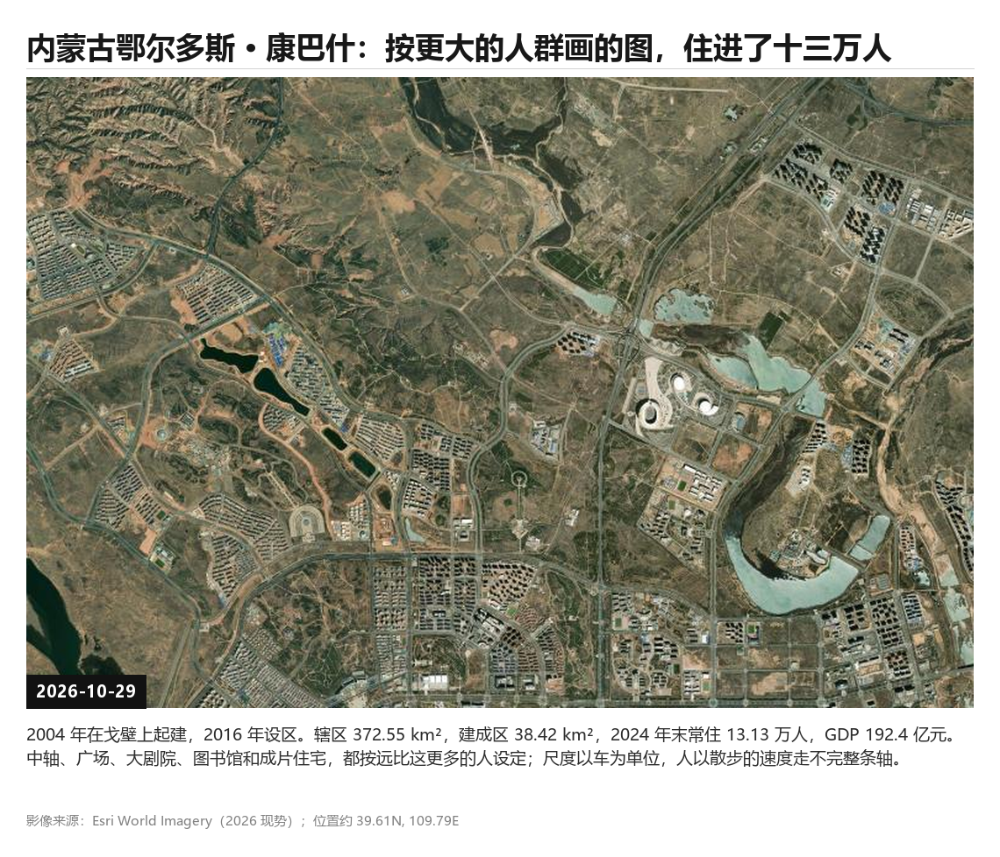
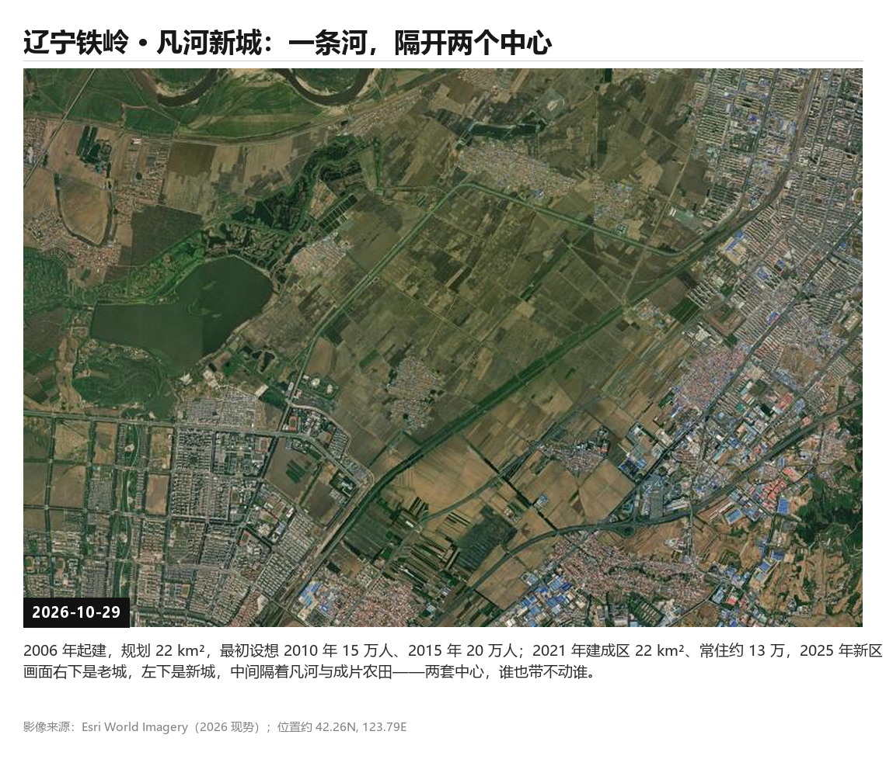
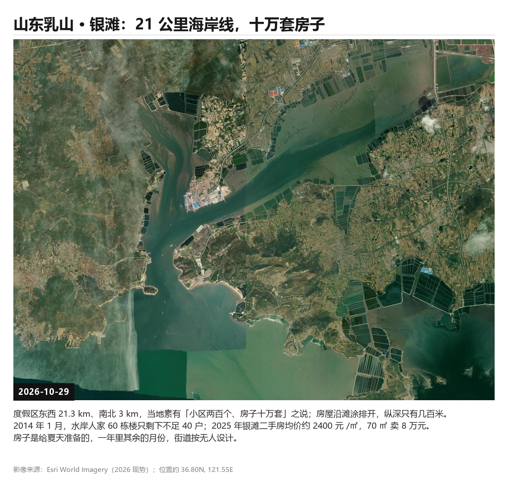
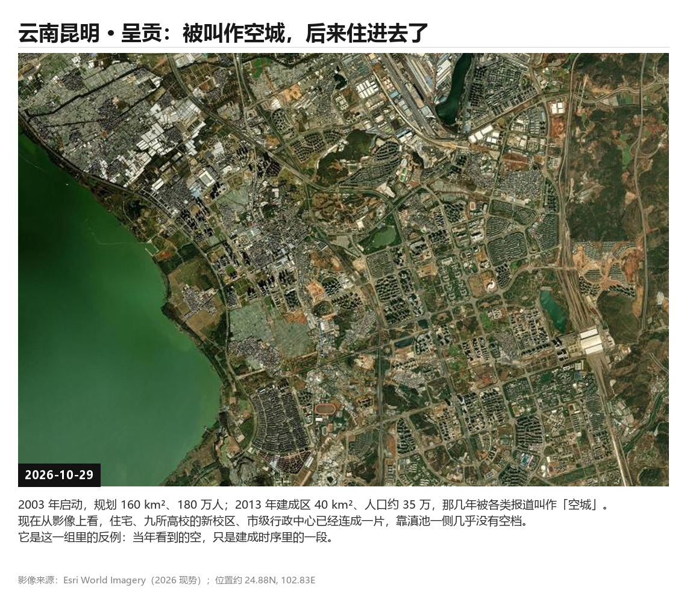
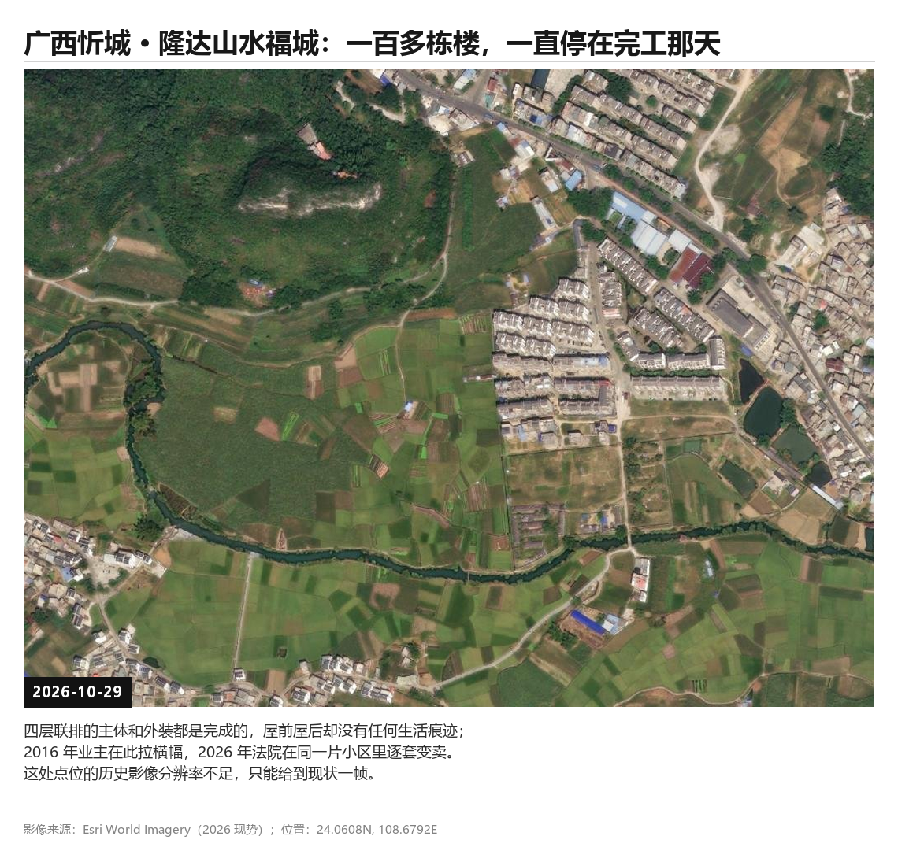
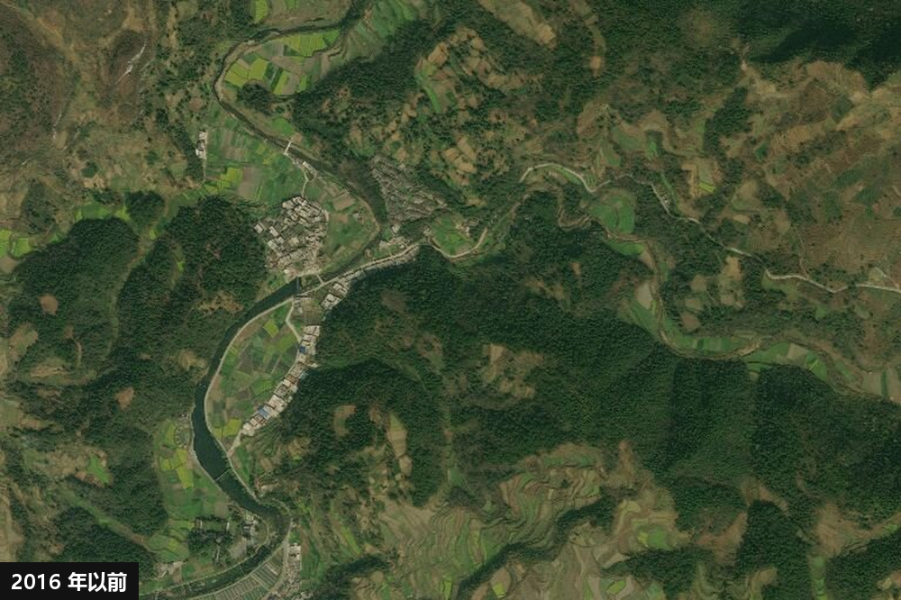

> 框架稿：章节已定，正文待填。


## 空置房的叙事
### 时间线


**政策走向与市场**
2015 年前后，棚改货币化把购房需求从一二线推向县域，乡镇一层开始出现成规模的商品住宅小区。这些小区大多建在人口流出、产业薄弱的地方，建成时卖得并不差，真正住进去的人却始终不多。2020 年三道红线落地，房贷集中度管理跟进，开发商的资金链先于购房者的耐心断裂；2021 年头部房企违约，期房停工从个别项目扩散成区域现象，多个城市出现业主停贷。2022 年起，地方政府以协调人的身份介入，3500 亿元保交楼专项借款开始贴息，金融十六条陆续落地，责任结构在停工现场被重新搭建。到 2024 年，政策重心从 “保交付” 转向 “消化存量”：5 月设立 3000 亿元保障性住房再贷款，预计带动银行贷款 5000 亿元；10 月专项债可以用于收购存量商品房。与此同时，烂尾项目更多走破产重整与共益债续建。于是今天的空置不再是单一的 “卖不掉”，而是三种状态并存：已建成却无人入住、停工待续的半成品、走完司法程序或被收储后重新有人住进去。

| 角色  | 先拿到什么                       | 承担什么                   | 风险暴露时点          |
| --- | --------------------------- | ---------------------- | --------------- |
| 政府  | 土地出让金、开发带来的税收与基础设施前置投入、城市面貌 | 配套投入、保交楼协调、收储资金、公共服务兜底 | 最晚，且可分散到财政与几年预算 |
| 开发商 | 预售款、规模、周转速度                 | 自有资金、负债、交付义务           | 中段，资金链一断立即暴露    |
| 购房者 | 一个「未来会交付的家」的预期              | 首付加二三十年按揭，几乎无法退出       | 最晚被通知，但代价最刚性    |
|     |                             |                        |                 |
### 相关案例

#### 视频参考
中國10大急速衰敗城市
https://www.youtube.com/watch?v=rJPJ5GSRvDo

#### 规划(大尺度)
##### 内蒙古鄂尔多斯 · 康巴什 - 曾经的鬼城 

https://cn.nytimes.com/culture/20150309/t09ordos/

>鄂尔多斯市中南部，市政府所在地。2004 年在戈壁滩上零起点规划建设，2016 年设为县级区，辖 4 个街道、21 个社区，辖区总面积 372.55 平方公里。建成区 38.42 平方公里，2024 年末常住人口 13.13 万人，城镇化率 98.4%，2024 年地区生产总值 192.4 亿元。街道与建筑尺度，是按远比这更多的人口设定的。

>内蒙古鄂尔多斯市**康巴什区**==曾因超前规划和煤炭经济波动被外媒冠以“鬼城”或“空城”之称，但如今已成功转型==。 [[1]]
>- **从荒漠到新城**：康巴什始建于2004年（地处毛乌素沙地边缘），2006年鄂尔多斯市政府迁入，2016年正式设立为市辖区。
>- **摆脱“空城”标签**：随着人口导入、行政与教育资源搬迁以及产业转型，常住人口与居民人气显著回升（常住人口超11万至15万人不等）。
>- **独特文旅名片**：康巴什是**中国首个以城市核心区身份获批的国家AAAA级旅游景区**，拥有成吉思汗雕塑广场、乌兰木伦湖区、多座特色图博建筑以及大型喷泉灯光秀。

```gallery
s=3

```

```gallery
"康巴什 · 现场"
"iphone"

```


##### 辽宁铁岭 · 凡河新城
http://district.ce.cn/newarea/roll/201310/14/t20131014_1617655.shtml

铁岭市区西南、凡河南岸，市委市政府坐落于此。2006 年始建，规划总面积 22 平方公里，最初设想 2010 年 15 万人、2015 年 20 万人。2021 年建成区 22 平方公里、常住人口约 13 万；2025 年新区 16 个社区常住人口约 8.1 万。老城在新城东北方向约 12 公里。

```gallery
s=3

```

```gallery
"凡河新城 · 现场"
"iphone"

```


##### 山东乳山 · 银滩
http://www.dzwww.com/xinwen/jishixinwen/201401/t20140109_9491415_16.htm

乳山市滨海新区东南海岸，AAAA 级旅游度假区，东西长 21.3 公里、南北宽 3 公里。房屋以卖给外地客的海景公寓与别墅为主，当地有「小区两百个、房子十万套」的说法。2014 年 1 月，水岸人家 60 栋楼里只剩不足 40 户；2025 年银滩二手房均价约 2400 元 /㎡，70 平方米一套成交 8 万元。

```gallery
s=3

```

```gallery
"银滩 · 现场"
"iphone"

```


##### 云南昆明 · 呈贡（反例）
http://cpc.people.com.cn/n/2013/1216/c83083-23847867-2.html

昆明主城东南、滇池东岸，距主城约 15 公里。2003 年启动新区建设，规划 160 平方公里、180 万人；2013 年建成区 40 平方公里、人口约 35 万，那几年被大量报道称为「空城」。到 2026 年，住宅、九所高校的新校区与市级行政中心已经连成一片，靠滇池一侧几乎没有空档。

```gallery
s=3

```

```gallery
"呈贡 · 现场"
"iphone"

```


#### 小区
##### 建德玉泉四季- 浙江建德寿昌镇
http://hznews.hangzhou.com.cn/jingji/content/2026-11/11/content_9369920.htm
```
当年**新房预售总价 641,461.28 元**，如今 9 万成交；小区规模约 33 万㎡，当年高层单价 7400 多元、总价 37 万起；现在二手房挂牌均价只剩 2900 多元 /㎡
```
```gallery
s=2


```

```gallery
"玉泉四季 · 现场"
"iphone"


```

##### 郑州雁鸣湖壹号烂尾别墅群
https://www.chinanews.com.cn/m/tp/hd/2016/0813/88807.shtml

```
397 栋独栋别墅、投资 120 亿、已签约 200 多栋、2015 年停工无人接手
```
```gallery
s=2


```

```gallery
"雁鸣湖壹号 · 现场"
"iphone"


```


##### 广西忻城隆达山水福城（村民在别墅间放牛）

[https://m.huanqiu.com/gallery/9CaKrnQhv9s](https://m.huanqiu.com/gallery/9CaKrnQhv9s)
https://news.66wz.com/system/2016/07/27/104893211.shtml
```
100 多栋四层别墅主体和外装都完成，屋里堆满垃圾、流浪汉住进去、河水变死水，2016 年 5 月近百位业主拉横幅维权，后来查实存在**一房多卖**，开发商还把楼和地皮抵押给了担保公司。

同一批房子同时压着业主、担保公司、施工方三层权利。
```

```gallery
s=3

```


```gallery
"山水福城 · 现场"
"iphone"


```


##### 贵州独山水司楼
https://photos.caixin.com/2025-10-03/102368570.html

```
2020 年停工照与 2025 年改造后酒店照并列，是「转换」这条路径少有的前后对比素材。
```
```gallery
s=3


```


```gallery
"水司楼 · 现场"
"iphone"


```


## 损失
### 可见的损失
1. **购房者**：首付加月供，损失最分散、最刚性，也最难集体行动。
2. **施工方与供应商**：垫资、商票、工程款，损失集中在少数企业，容易出现连锁。
3. **债权人与金融机构**：通过破产重整折价清偿，损失被会计化、被摊薄。
4. **地方政府**：保交楼协调、收储价差、后续配套与公共服务，最终由财政承担。

### 业主能获得的赔偿
#### 能续建交付：拿到房子，不算赔偿

保交楼协调、破产重整续建、共益债注资，目标都是 “交付”。这时购房者不是债权人，仍是买房人，只要按管理人通知补付剩余房款，就能拿房办证。这是实务中最好、也最常见的结果。

#### 交付不了：退款，第一顺位

最高法《关于商品房消费者权利保护问题的批复》（法释〔2023〕1 号）明确了两件事：

- 以居住为目的、已付**全部价款**的购房者，其**房屋交付请求权**优先于建设工程价款优先受偿权、抵押权和其他债权；
- 房屋**不能交付且无实际交付可能**时，其**价款返还请求权**同样优先于上述权利。

只付了部分价款的，在一审法庭辩论终结前补足剩余价款，也可适用。

2026 年 9 月《全国法院审理房地产开发企业破产案件座谈会纪要》（法〔2026〕137 号）把这一顺位写进了破产清偿顺序：**第一位是商品房消费购房人已支付的购房款和尚未归还的个人按揭贷款**，第二位才是建设工程价款优先债权，第三位是担保债权。

“优先” 不等于 “全额”：破产财产不足时，同一顺位按比例分配。所以能拿回几成，取决于那个项目还剩多少可处置资产。

#### 延迟交付（实际又未交付）

如果在项目**还有续建可能**的时候，以 “迟延交付” 为由主张解除合同，按 2026 纪要第 17 条，购房款返还请求权和损害赔偿请求权会**降为普通债权**清偿 —— 位置从第一顺位掉到最后，实际清偿率可能只有个位数。

等的房子和要的钱，是两条完全不同的路，选择时机几乎决定了损失大小。

#### 后续的月供（征信与断供）

房子烂尾但买卖合同没解除，**贷款合同仍然有效，月供还得还**

买卖合同解除后，致担保贷款合同目的无法实现，可依《商品房买卖合同司法解释》第 20 条请求解除贷款合同；解除后，出卖人应将收受的购房贷款和购房款的本金及利息**分别返还银行和购房人**。也就是说，这时的追偿对象是开发商，不是银行。

单方停贷不属于法定救济，通常构成违约并影响征信，这也是 2022 年那批停贷最终多转为协商或等待交付的原因。

### 建筑学角度的思考
第五个承担者：空间本身

损失不只被会计化，也被**空间化**：半成品楼的钢筋裸露、外墙保温失效、门窗锈死、管线无水无电地老化。这些物理后果没有主体认领，也没有人核算它的长期成本，因为账本上它已经「计提」完了。

这里出现一个错位：**财务上的损失可以核销，空间上的损失只能继续存在。** 一栋楼在资产负债表上可能已经清零，但它还站在那儿，每年继续劣化。

这个错位就是：把「损失的空间化」当成研究对象，追问一句 —— 当所有主体都完成了账务处理，谁来为这栋还在衰败的建筑负责？


